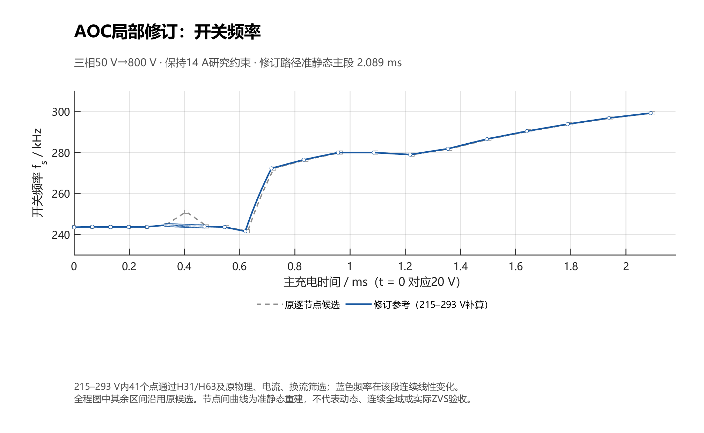

# 三相 LCC 电容充电电源 AOC 策略一页式总览（最终版）

> 本页是给人和 LLM 共同读的总览。所有数值的出处、模型层级和禁用表述，以文末链接的详细文档为准。
> 最终版定义：**文献层 = Qin 等 2023（JESTPE 11(6): 5675–5689）**；**项目层 = 59 节点 `aoc_smooth254_59_nodes.csv`（2026-10-20 定稿，2026-10-24 完成 20 点验证）**。

---

## 0. 一句话

Qin 等 2023 提出 AOC：在谐振电流上限、ZVS 边界和频率上下限约束下，随输出电压实时求最大可行输出电流参考，使单相 LCC 在相同峰值电流下充得更快。本项目把“逐电压点求最大可行输出电流”的目标迁移到 50 V→800 V 三相 Δ/Y LCC，用 HOGA 离散网格生成 **59 节点 `fs(Vo)` 查表轨迹**；这是**离线开环前馈**，不是原论文的在线电流闭环，也没有硬件验证。

---

## 1. 两层对象（不要混）

| | 文献层 | 项目层 |
|---|---|---|
| 对象 | 单相 LCC 全桥 CCPS | 三相三桥臂 Δ/Y LCC |
| 参数 | 45 V→720 V，8.13 mF，1:16，2174 W，61–67 kHz | 50 V→800 V，3.125 μF（1 J），1:4，241.6–299.3 kHz |
| 模型 | CRC-FHA（连续谐振电流基波近似） | HOGA（V2.2 快照；H31/H63 搜索，H49 验证） |
| 约束 | `Im ≤ Imax`、`Xin > 0`、`1 < Fn < fmax/fr` | HOGA 守卫/阶数/CCM、相峰值 ≤14 A、换流电荷代理 ≥1.40019 A、210–340 kHz |
| 控制 | 在线算 `Fnmin` → `Iref` → 电流 PI → PFM | 离线逐点搜索 → 59 节点 `fs(Vo)` 表 → 开环前馈 + 连续相位 + 800 V 锁存 |
| 终端 | Burst 恒压（跌到 `Uref2` 重启） | 800 V 锁存封锁，继续求解残余能量，**不自动重启** |
| 证据 | 2174 W 样机实验 + 热仿真 + 末端 ZVS 波形 | 冻结 `Vo` 的 Simulink 理想开关参考 + 20 点 HOGA 验证；**无硬件** |
| 结论 | 相同 `Imax` 下 1.82 s→1.62 s（速度 +12.35%） | 理想开关模型 2.596206→2.153487 ms（−17.05%，同模型同口径） |

---

## 2. 文献 AOC：问题、模型、策略、结果

### 2.1 问题

电容充电时 `Uo` 持续升高，整流导通角、谐振电流应力和 ZVS 余量都随工作点变化：

- **CC**：平均输出电流恒定，但末期谐振电流应力最大 → 末期先碰 `Imax`，前段能力没用足；
- **CP**：`Io ≈ P/Uo`，低压段电流很大 → 初期先碰器件限制，后段能力又闲置；
- **HCC–CP**：先恒流后恒功率，缓解两端极端，但分段折线仍不一定贴住每个电压点的可行输出上边界。

AOC 的问题因此是：**给定同一 `Imax`、ZVS 和频率约束，怎样在每个 `Uo` 点取尽可能大的 `Io`？** 对理想输出电容、准静态条件，`Io` 越大 `dUo/dt` 越大，充电时间越短。

### 2.2 CRC-FHA（为什么选 `ir` 而不是 `iT`）

传统 FHA 用变压器电流 `iT` 的基波；`iT` 在整流截止区间为零、谐波大，且常忽略 `uCp` 与 `iT` 的相位差。论文改用**连续、近似正弦的谐振电流 `ir`**，保留 `uCp` 与 `ir` 的相位关系，建立 Fig.5 等效网络。核心关系（论文式 (2)(11)(12)(13)）：

```
ir(t) = Im sin(ωt)
M = Uo/(n Uin),  Fn = fs/fr,  fr = 1/(2π√(LrCr)),  k = Cp/Cr
Io = Im (1 − cosθ)/(nπ)
Im = 2ω Cp Uo / [n(1 + cosθ)]
```

`θ` 是整流二极管半周期导通角；`Io` 同时取决于 `Im` 与 `θ`，所以“相同谐振峰值”不对应“固定输出电流”。论文用 `k = 0.213` 的拟合式 (11) 把 `cosθ` 写成 `M`、`Fn` 的函数，进而得到 `Io = f(M,Fn)`、`Im = g(M,Fn)`。**式 (11)/(15)/(19) 是该样机参数下的近似，不是所有 LCC 的通式。**

### 2.3 三条约束

1. **电流应力边界**：由式 (13)(14) 得 `Im ≤ Imax`，代换后得到 `Fnmin1`（论文式 (15)，关于 `M`、`Fn` 的多项式不等式）。
2. **ZVS 边界**：输入电抗感性，`Xin > 0`：

```
Xin = ωLr − 1/(ωCr) + (θ − π − cosθ sinθ)/(πωCp) > 0        (16)
kπ(Fn² − 1) + 0.4434 cos3θ − 2.031 cosθ − 1.571 > 0           (17)
```

   把式 (11) 的 `cosθ(M,Fn)` 代入 (17)，得 `Fnmin2`（式 (19) 的展开多项式）。
3. **频率范围**：`1 < Fn < fmax/fr`（式 (18)），即 `fr < fs < fmax`。

**A 点**是 `Imax` 边界与 ZVS 边界的交点：A 点前电流边界更紧，轨迹沿 `Imax`；A 点后继续沿 `Imax` 会破坏感性条件，改沿 ZVS 边界，`Im` 可低于 `Imax`。所以 AOC 曲线既不是恒流也不是恒功率。

### 2.4 三阶段控制

| 阶段 | 条件 | 行为 |
|---|---|---|
| 1 预充 | `Uo < Uref1`（40 V，约 0.05 Uref） | 固定 `fs1` 涓流充电，避开零压启动 |
| 2 AOC | `Uref1 ≤ Uo < Uref`（720 V） | 采样 `Uo` → 算 `M` → 解 `Fnmin1`、`Fnmin2` → 式 (20) 取 `Fnmin` → 式 (11) 得 `cosθ` → 式 (13) 得 `Iref` → 电流 PI → PFM |
| 3 恒压 | `Uo ≥ Uref` | Burst：停充，漏电跌到 `Uref2` 再以 `fs2` 工作若干周期 |

式 (20) 原文：

```
Fnmin = min{ fmax/fr , max(Fnmin1, Fnmin2) }        (20)
```

内层 `max` 合并两个下界；外层 `min` 是上限截断。**若所需下界已超过 `fmax/fr`，截断值仍违反原约束**——工程实现必须先判可行区间非空，不能把截断值称为“最优可行解”。

### 2.5 实验与证据

- 2174 W 单相样机：`Uin = 45 V`、`Uref = 720 V`、`n = 16`、`Co = 8.13 mF`、`Imax = 105 A`、`fr = 50 kHz`、`Lr = 1.63 μH`、`Cr ≈ 6.22 μF`、`k = 0.213`；AOC 实际 `fs` 上限 67 kHz、下限 61 kHz（HCC–CP 下限 64 kHz）。
- 相同 `Imax`、相同 720 V 目标：HCC–CP **1.82 s**，AOC **1.62 s**。论文写“充电速度提高 12.35%”，即 `1.82/1.62 − 1 = 12.3457%`；若按时间缩短口径则是 `(1.82−1.62)/1.82 = 10.99%`。**两个口径不能混。**
- 热：ANSYS Icepak 半桥模块热仿真，环境 20 °C，AOC 温升 42.3 °C、HCC–CP 53 °C；为放大差异，**损耗和作用时间都乘了 4**。这是热仿真，不是实测温升。
- ZVS：Fig.27 给出 720 V 末端波形；作者以“末端最难 ZVS”的模型判断 + 该波形支持“全程 ZVS”。**不是每个中间电压都做了逐点实验。**
- 结论段写“12%”“10.7 °C”，是取整口径；引用时用 §V-B 的 12.35% 并注明算法。

---

## 3. 项目最终 AOC：59 节点查表轨迹

### 3.1 优化问题

在固定主电路、固定 14 A 研究情景下，逐电压点求最大平均整流电流：

```
fs*(Vo) = arg max  Io(Vo, fs)
          fs ∈ F(Vo)

F(Vo) = { fs : HOGA 物理守卫/阶数/CCM 通过,
               max_j |i_j| ≤ 14 A,
               min_ℓ i_comm,ℓ ≥ 1.40019 A,
               210 kHz ≤ fs ≤ 340 kHz }
```

- `Io` 是三相共用的平均整流输出电流；不是三个单相电流相加。
- `i_comm` 是 100 ns 命令死区 + RC 门极近似对应的有效换流窗口内、按方向取符号的相电流；1.40019 A 由半桥 `Qreq ≈ 111.010 nC` 与有效窗口 79.281831 ns 得到，是**必要能力代理**，不是 ZVS 认证。
- HOGA 主方程仍是**零物理死区、0.6 V 整流简化基准**；Coss/Cj 动态不在稳态方程内。

### 3.2 怎么得到 59 节点

1. 复用既有 423 个通过守卫的 HOGA 点；扩域 377 条、模态恢复 88 条、局部频率加密 261 条（含失败与不同验收层级，不能相加称“全部有效独立点”）。
2. 先做线性频率插值检查，发现轻微 14 A 越界和模态/求解失败；改为 **20 个独立电压区间**（中间实施表，见 `docs/03` 版本表），每区间取一个固定频率，对两端 + 中点做三点核验；不跨区间线性插值，以保留检查过的分支。
3. 逐节点候选在 254 V 出现 251.064 kHz 的向上尖峰；用已验收 293 V 解作初值，恢复被遗漏的低频分支，得到 254 V / 244.8 kHz 的可行解。为避免尖峰，215–293 V 改用**直线频率桥**：

```
fs(Vo) = 244614.9 + (243932.0 − 244614.9)·(Vo − 215)/78   [Hz]
```

   在该段每 1.95 V 检查一次，共 41 点，全部通过 H31/H63、代数闭合、物理守卫、CCM、相峰值 ≤14 A、换流代理筛选。
4. 41 个新局部点 + 18 个保留原节点 = **59 节点**；加 0–20 V 的 300 kHz 启动段，共 61 个查表断点。

### 3.3 最终表的关键数

| 量 | 值 |
|---|---:|
| 节点数 | 59（20–800 V） |
| 频率范围 | **241.5905–299.2573 kHz** |
| 0–20 V 启动 | 300 kHz |
| 相峰值最大 | **13.99995 A**（59 V 节点；距 14 A 仅 0.00005 A，属贴线） |
| 换流代理最小 | **1.43999 A**（683 V 节点；阈值 1.40019 A，余量约 2.8%） |
| `Io` 范围 | 1.85547 A（20 V）→ 0.79996 A（800 V） |
| 准静态 20→800 V | **2.089438 ms** |
| 轨迹形状 | 20–215 V 约 243.6–244.6 kHz；215–371 V 由 244.61 降至 241.59（371 V 为全表最低）；410 V 跳至 272.27；之后升到 299.26 kHz |

> 轨迹**不是单调调频**：低压段用低频率换大电流，371 V 附近取全表最低频，410 V 因模态/换流分支切换跳回 272 kHz，再随电压升频。论文里必须解释这个“非单调、分段”的形态，不能画成一条光滑单调曲线。



> 图：`fs`–时间（t=0 对应 20 V），准静态重建，2.089 ms；不是开关级动态波形。371 V 处 241.59 kHz 为全表最低，410 V 跳至 272.27 kHz。

### 3.4 动态验证（理想开关 + 二极管压降）

- 模型：`AOC_charge.slx`，`Vo → fs` 1-D 查表（Flat），三相 120° 连续相位，100 ns 采样锁存 `q[k+1] = q[k] OR (Vo[k] ≥ 800)`；ode15s，RelTol 2e-7、AbsTol 2e-9、MaxStep `1/(200·299257)`，Stop 3.5 ms。
- 器件：`Ron = 1e-6 Ω`、`Vf = 0.6 V`、`Goff = 1e-11`、`td = 0`、`Coss = 0`（**没有** Coss/Cj、没有物理死区）。
- 结果：`t800 = 2.153487 ms`；3.5 ms 末值 800.112 V；同模型旧 21 节点 280–299 kHz 表为 2.596206 ms，缩短 **17.05%**；完全理想器件（`Vf=0`、`Ron=eps`）为 2.151012 ms。
- 准静态交叉核对：2.089438 ms（20→800 V）+ 65.456 μs（0→20 V 共同启动，借用 M2 的诊断值）= 2.154894 ms，与 2.153487 ms 差约 0.065%，仅作量级自洽检查（启动时间是 M2 口径，不是 M1 的严格同层值）。

### 3.5 20 点模型精度

在 `[0, t800]` 二十等分取中点，冻结 `Vo` 跑 24 周期 Simulink 理想开关参考，再用 HOGA-H49 / EDF / FHA 求解：

| 指标 MAPE | HOGA-H49 | EDF | FHA |
|---|---:|---:|---:|
| 三相平均 RMS | **0.00391%** | 0.391% | 13.027% |
| 平均输出电流 `Io` | **0.00566%** | 0.349% | 10.921% |
| 三相峰值 | **0.0270%** | 1.573% | 13.784% |
| 波形 NRMSE | **0.0307%** | 2.138% | 23.851% |


> 图：20 个冻结点上 HOGA-H49 / EDF / FHA 与 Simulink 参考的平均输出电流；参考为冻结 `Vo` 的理想开关模型，不是器件近似模型或硬件。

- 20/20 有效；HOGA 最大单点 `Io` 误差 0.0164%（673.7 V）。
- 379.4 V / 241.59 kHz 是全表最低频、相峰值接近 14 A 的点：EDF `Io` 误差 1.171%、FHA 25.37%，HOGA 0.0098%。
- 17.4 V（每周期 7% 电压变化）与 79.8 V（3.02%）不满足准静态，应单列“瞬态-冻结对照”，不能计入准静态精度统计。

---

## 4. 模型层级：哪些数能放在同一张表

| 层 | 模型 | 关键结果 | 能写什么 |
|---|---|---|---|
| M0 | 理想开关（`Ron=Vf=0`，无死区） | 59 节点 `t800 = 2.151012 ms` | 控制/轨迹层面的理想上限 |
| M1 | 理想开关 + `Vf=0.6 V`、`Ron=1e-6` | 59 节点 `t800 = 2.153487 ms`；旧 21 节点 2.596206 ms | 同模型、同口径的轨迹对比 |
| M2 | 器件近似（100 ns 命令死区、MOS Coss、整流 Cj、RC 门极） | 旧 21 节点 AOC 2.572428 ms；定频 300 kHz 2.940227 ms；400 V 候选 2.687160 ms；三者相峰值 14.28–14.31 A，启动各 4 次残压失败，主段 0 | 器件约束下的可行性诊断；**不是最终 59 节点表的结果** |
| M3 | 硬件 | 无 | 不能写 |

**M2 的 800 V 末端**：7 个离散频点（280/285/290/295/297/299/300 kHz）中，280–290 kHz 满足 14 A 但各有 60/60 残压失败；295–300 kHz 残压通过但相峰值 14.17–14.31 A 超限。**没有同时满足两项的离散点**；290–295 kHz 未连续精查，不能外推为“纯 PFM 全频域无解”。

**关键缺口**：最终 59 节点表**只在 M0/M1 跑过全程**；M2 下没有它的全程结果。论文若把 §4.1.3 改成 59 节点，第六章（2026-10-19 稿）的 2.572428 ms / 12.509% / 3.180% 仍是 21 节点 + M2 的口径，**必须重跑或明确标注**，不能与 2.153487 ms 并列成一张“策略对比表”。

---

## 5. 可写 / 不可写（速查）

### 可以写（有证据）

- “Qin 等提出 AOC，在 `Imax`、ZVS、频率约束下实时生成输出电流参考；单相 2174 W 样机在相同 `Imax` 下把 720 V 充电时间从 1.82 s 降到 1.62 s（速度提高 12.35%）。”
- “本文借鉴 AOC 的‘逐电压点最大化可行输出电流’目标，在 50 V→800 V 三相 Δ/Y LCC 上构造离线 `fs(Vo)` 查表轨迹。”
- “最终 59 节点表的频率范围 241.5905–299.2573 kHz，准静态 20→800 V 为 2.089438 ms；理想开关+二极管压降模型 `t800 = 2.153487 ms`，同模型旧 21 节点表为 2.596206 ms。”
- “20 个冻结工作点上，HOGA-H49 的 `Io` MAPE 为 0.00566%，最大单点 0.0164%。”
- “14 A 与 1.40019 A 是研究情景/代理阈值，不是器件额定或 ZVS 认证。”

### 不能写（无证据/易误导）

- “本文实现了 AOC 策略/在线电流闭环。”——只做了开环查表。
- “三相 AOC 是本文首次提出。”——AOC 是 Qin 2023 的；三相迁移本身不构成已证创新。
- “14 A 约束满足/器件安全。”——13.99995 A 是贴线；M2 下旧轨迹全超；14 A 本身是情景。
- “全程 ZVS。”——只有残压代理和局部诊断，没有硬件。
- “充电时间缩短 17.05% 是相对 HCC–CP/文献的收益。”——17.05% 是**同模型、同口径**相对旧 21 节点表；不能跨模型、跨对象。
- “效率提升 3.18% / 温升降低 10.7 °C。”——3.180% 是 M2 下直接器件耗散的相对差（0.3351 mJ），不是整机效率；10.7 °C 是文献热仿真（且损耗×4）。
- “全局最优/连续域无解。”——离散 HOGA 网格 + 局部加密，未做连续全域证明。
- “12.35% 可直接迁移到三相。”——对象、参数、模型都不同。

---

## 6. 与论文草稿的衔接

2026-10-19 合排稿 §4.1.3 目前写的是 **21 节点**表（527 V→281 kHz、566 V→280 kHz、800 V→299 kHz），并明确“不包含文献[1]的完整在线电流参考求解和电流 PI 闭环”。若按最终版改写：

| 位置 | 现在 | 最终版应改为 |
|---|---|---|
| §4.1.3 节点数 | 21 | **59**（20–800 V），0–20 V 仍 300 kHz |
| 频率范围 | 280–299 kHz | **241.59–299.26 kHz** |
| 轨迹形态 | 高压段升频 | 低压段低频大电流 + 371 V 最低点 + 410 V 分支跳变 + 高压升频 |
| 充电时间 | 2.572428 ms（M2，21 节点） | 准静态 2.089438 ms；M1 动态 2.153487 ms（分列） |
| 约束 | 14 A 情景 + 残压诊断 | 14 A + 换流代理 1.40019 A + HOGA 守卫/阶数/CCM + 210–340 kHz |
| 第六章 | 2.572428 / 12.509% / 3.180% | 要么重跑 59 节点 M2，要么保留为“21 节点历史对照”并加模型标签 |

段落骨架、图表建议和 GPT 提示词见 [`docs/06_writing_guide.md`](docs/06_writing_guide.md)。

---

## 7. 导航

- 文献精读：[`docs/01_paper_AOC_digest.md`](docs/01_paper_AOC_digest.md)
- 公式与符号：[`docs/02_equations.md`](docs/02_equations.md)
- 最终轨迹：[`docs/03_project_AOC_final.md`](docs/03_project_AOC_final.md)
- 验证与证据：[`docs/04_validation.md`](docs/04_validation.md)
- 可写/不可写：[`docs/05_claims_and_boundaries.md`](docs/05_claims_and_boundaries.md)
- 写作指南：[`docs/06_writing_guide.md`](docs/06_writing_guide.md)
- 来源索引：[`docs/07_sources.md`](docs/07_sources.md)

---

*本页由既有论文、报告、CSV/JSON 整理，未新增 MATLAB/Simulink/Maxwell 求解或实验。最后整理：2026-10-25。*
